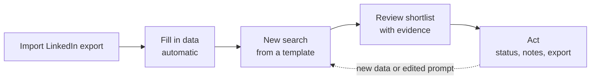

# 01 Product plan

## Problem

v1 grew feature by feature. Users see many buttons with no order, type free-form prompts and expect AI to know things about people that the app never collected. Results then look wrong ("it can't find anyone who worked at CTP") when the real cause is missing data.

v2 fixes this with three ideas:

1. **One workflow** that the UI walks people through: Import, Fill in data, Search, Review, Act.
2. **Automatic research** that collects and saves company, job, technology and career data from the public web, so data exists before anyone searches.
3. **Templates instead of blank prompts**, so people can only ask for things the system has data for, and the system tells them when data is missing.

## Users

| Role | Who | Can do |
|---|---|---|
| Super admin | Pasindu only | Everything, plus allow list, templates, AI limit, people, activity log |
| User | Anyone at 1billiontech.com who signs in with Google | Own profiles, imports, searches, sharing their own profiles |

Users are sales and leadership people, not technical. Assume they will type vague requests and trust whatever comes back. The system must keep them on rails.

## The workflow

| Step | What the user does | What the system does |
|---|---|---|
| Import | Uploads `Connections.csv` from LinkedIn | Cleans names and companies, merges duplicates, starts research |
| Fill in data | Nothing, or watches progress | Researches each company once and each person once, saves facts with sources, refreshes on a schedule |
| Search | Picks a template, fills a few fields | Shows the prompt, runs a data check, filters for free, then scores with AI |
| Review | Reads High and Medium results | Shows the reason and evidence links per person, and what changed since the last run |
| Act | Marks contacted, adds notes, exports | Records status and keeps every run in history |

## Scope

### In v2
- Google sign-in for the company domain, no guests
- Super admin role, activity log visible only to the super admin
- Profiles owned by a user, shared as Editor or Viewer, never merged
- Server side storage in MongoDB Atlas (replaces browser only storage)
- Automatic research worker: companies, open jobs, technologies, people
- Saved research reused by every search, with refresh schedule
- Shared, versioned templates managed by the super admin
- Search flow with data check, free pre-filter, AI scoring, evidence
- Run history per search with "new since last run"
- One organisation AI limit ($10 a day), spend shown per person
- `notify()` hook for later email features (no email sending yet)

### Not in v2
- Email sending or sequences
- Sales Navigator or 2nd-degree prospects
- Paid data providers for job boards (decided: web search only)
- Mobile layout beyond "usable on a tablet"
- Per user AI limits

## Phases

| Phase | Delivers | Done when |
|---|---|---|
| 0 Documents | This folder, screen designs | Pasindu signs off |
| 1 Foundation | Google sign-in, allow list, roles, profiles, sharing, MongoDB storage, activity log, v1 data import | A guest and a staff user can sign in, own and share profiles; super admin sees activity |
| 2 Company research | Worker and queue, website finding, company facts, open jobs, technologies, refresh | 85% or more of companies have a verified website, jobs found for most with a careers page |
| 3 Person research | Career, skills, mentions, identity check, refresh | Career found for 30% or more of people, zero facts without a source |
| 4 Search v2 | Templates, data check, pre-filter, AI scoring with evidence, run history | The CTP style search returns cited results and explains gaps |
| 5 Switch-over | v1 users moved, v1 retired | All active users on v2 for one week with no blocking bug |

Phases 2 and 3 can overlap. Phase 4 needs data from 2 and 3 to be useful.

## Success measures

- Companies with a verified website: 85% or more
- People with at least one career fact: 30% or more (limited by what is public)
- Searches that run on templates: 100%
- Results with at least one evidence link: 100% of High and Medium
- AI spend stays under the $10 daily limit with no failed runs, only paused ones
