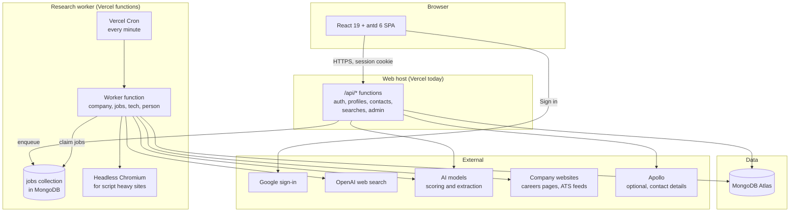
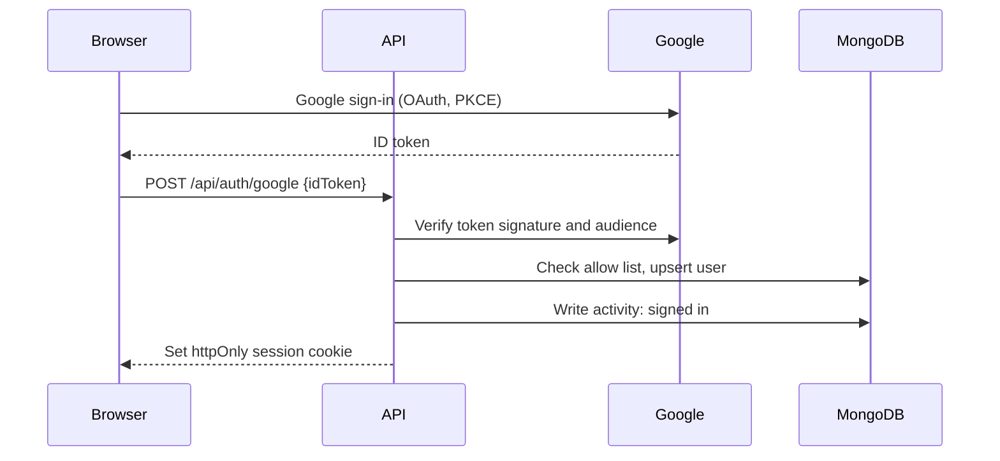
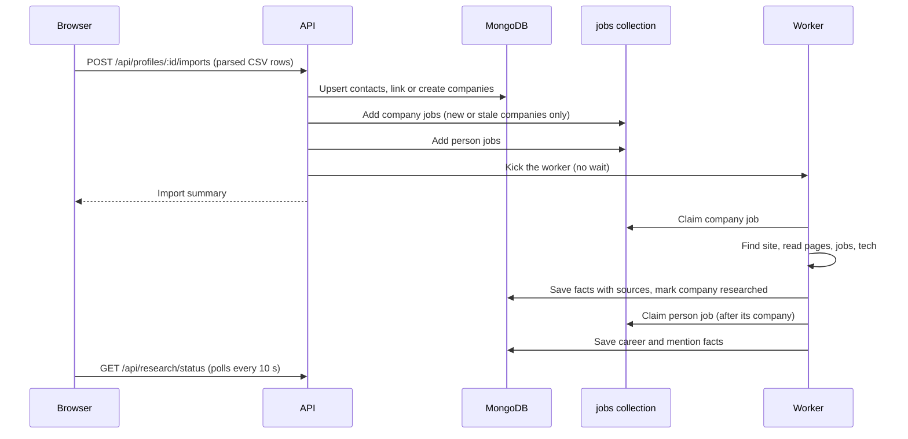
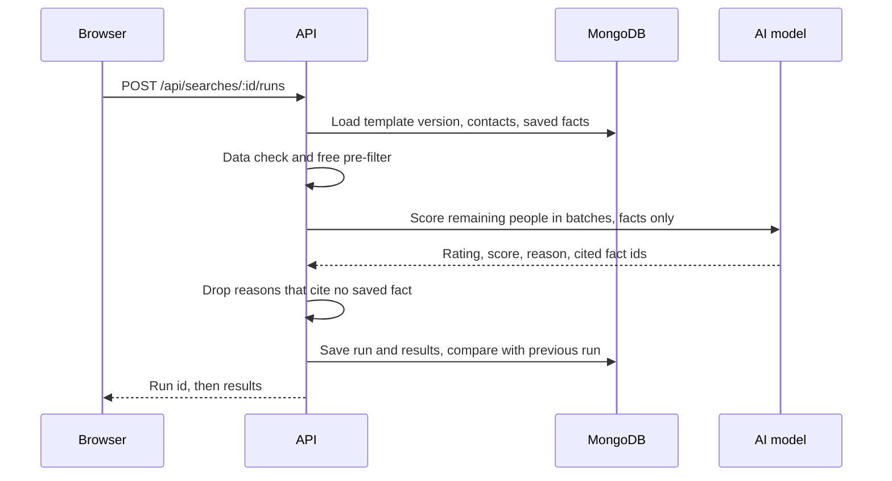

# 02 Architecture

## Overview

## Components

| Component | Tech | Responsibility |
|---|---|---|
| Web app | React 19, Vite, antd 6, Geist, Tabler icons | All screens. No direct database access. Keeps a small Dexie cache for fast tables only |
| API | TypeScript functions in `api/`, same handlers on Vercel and the dev server | Sessions, permissions, reads and writes, enqueueing research, running searches, activity log writes |
| Research worker | Vercel function `api/worker.ts`, started by Vercel Cron every minute (and kicked right after an import) | Claims jobs from the `jobs` collection, works for up to about 4 minutes, then stops. One job is one company or one person, so each is short and retried on its own |
| Headless browser | `playwright-core` with `@sparticuz/chromium` inside the worker function | Only for sites whose content appears after scripts run. Plain fetch is tried first |
| Scheduler | Vercel Cron, hourly | Finds facts past their refresh date and adds jobs |
| Database | MongoDB Atlas (region to be confirmed) | Users, profiles, contacts, companies, facts, searches, runs, templates, activity, spend |
| AI | OpenAI Responses with `web_search` for finding pages; a model for extraction and scoring | Company key on the server. Users no longer paste their own key |

### Why a queue, all on Vercel

Everything runs on Vercel (decision D7). A single function can't research 1,000+ companies because functions stop after a few minutes. So the work is split into small jobs saved in a MongoDB `jobs` collection. Every minute Vercel Cron starts the worker function, which claims a few jobs, runs them, and stops before its time limit. Failed jobs are retried, and jobs pause at the AI limit and continue the next day.

Requirements:
- **Vercel Pro plan.** Hobby only allows cron once a day and shorter functions
- Worker function `maxDuration` 300 seconds, memory 2 GB (for Chromium)
- Cron calls carry `CRON_SECRET`, so nobody else can start the worker
- The AWS files (`infra/`, `lambda/`, `DEPLOY-AWS.md`) are not used by v2 and can be removed at switch-over

## Main flows

### Sign in

### Import and automatic research

### Search

Long searches run as a worker job too, using the same queue, when the candidate count after pre-filtering is above 300.

## Environments

| Environment | Web and API | Worker | Database |
|---|---|---|---|
| Local | `npm run dev` | `npm run worker` loop | `leads_dev` |
| Preview | Vercel preview of `revamp-v2` | Same deployment, cron off; started by hand | `leads_staging` |
| Production | Vercel production | Same deployment, cron on | `leads` |

## Security

- Session: signed, httpOnly, Secure, SameSite=Lax cookie, 14 day expiry, renewed on use
- Every API call checks the session, then the user's role on the profile involved
- CSRF: SameSite cookie plus a required `X-Requested-With` header on writes
- Worker endpoint only runs with the `CRON_SECRET` header
- Outbound fetches: blocked list (LinkedIn, Indeed, Glassdoor, private IP ranges), 10 s timeout, 2 MB page limit, robots.txt respected
- Secrets: `MONGODB_URI`, `GOOGLE_CLIENT_ID`, `SESSION_SECRET`, `OPENAI_API_KEY`, `APOLLO_API_KEY` in environment variables only
