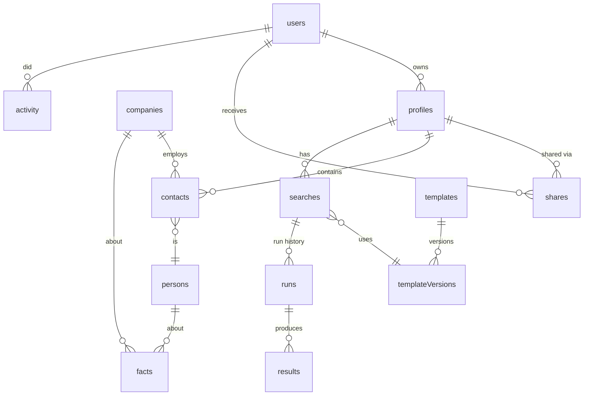

# 03 Data model (MongoDB)

One database, `leads` (`leads_staging` for preview). All ids are strings (ULID) so they sort by creation time. All documents have `createdAt` and `updatedAt`.

## Collections

### users
| Field | Type | Notes |
|---|---|---|
| `_id` | string | |
| `email` | string | Lowercase, unique |
| `name`, `picture` | string | From Google |
| `role` | `superadmin` \| `user` | Only one super admin, set by environment variable `SUPERADMIN_EMAIL` |
| `status` | `active` \| `disabled` | |
| `lastSignInAt` | date | |

### allowList
| Field | Notes |
|---|---|
| `type` | `domain` or `email` |
| `value` | `1billiontech.com`, or a single Google email the super admin allows |
| `addedBy`, `addedAt` | |

### sessions
`_id` (random 32 bytes, hashed), `userId`, `expiresAt` (TTL index), `userAgent`.

### profiles
`_id`, `ownerId`, `name`, `contactCount`, `deletedAt` (soft delete, 30 days).

### shares
`profileId`, `userId`, `access` (`editor` \| `viewer`), `grantedBy`. Unique on `profileId + userId`.

### companies (shared across all profiles)
| Field | Notes |
|---|---|
| `_id` | |
| `key` | Normalised name, unique. "Example Holdings (Pvt) Ltd" and "Example Holdings" share one key |
| `names` | Every spelling seen |
| `domain` | Verified website domain or null |
| `domainStatus` | `verified` \| `guessed` \| `not_found` |
| `researchedAt`, `nextRefreshAt` | |
| `summary` | Denormalised latest facts for fast tables: industry, size, hq, tech[], openJobs count |

Company facts are public business information, so one company record serves every profile. This is what makes research cheap.

### persons (shared across profiles)
`_id`, `key` (LinkedIn URL, else name + company key), `name`, `researchedAt`, `nextRefreshAt`, `summary` (location, pastEmployers[], skills[]).

### contacts (per profile)
| Field | Notes |
|---|---|
| `profileId`, `personId`, `companyId` | |
| `firstName`, `lastName`, `title`, `email`, `linkedinUrl`, `connectedOn` | From the LinkedIn export |
| `status` | `new` \| `contacted` \| `replied` \| `meeting` \| `not_interested` |
| `notes` | Array of `{by, at, text}` |
| `tags` | string[] |

Unique on `profileId + personId`.

### facts (the research store)
| Field | Type | Notes |
|---|---|---|
| `subject` | `{type: 'company' \| 'person', id}` | |
| `field` | string | `website`, `industry`, `size`, `hq`, `office`, `founded`, `news`, `tech`, `job`, `career`, `skill`, `mention`, `location` |
| `value` | object | Shape per field, for example job: `{title, location, url, postedAt}` |
| `sourceUrl` | string | Required. No source, no fact |
| `sourceKind` | `site` \| `careers` \| `ats` \| `search` \| `news` \| `event` \| `code` | |
| `quote` | string | Short text from the page that supports the fact, up to 300 characters |
| `confidence` | 0 to 1 | |
| `foundAt`, `lastSeenAt` | date | |
| `supersededAt` | date or null | Set when a refresh replaces it. Kept for history |

Indexes: `subject.id + field + supersededAt`, `lastSeenAt`.

### templates and templateVersions
`templates`: `_id`, `name`, `description`, `currentVersion`, `archived`.
`templateVersions`: `templateId`, `version`, `fields[]` (inputs the user fills), `requiredFacts[]` (for the data check), `prefilter` (rules), `promptText`, `ratingRules`, `createdBy`. Never edited after creation.

### searches
`profileId`, `name`, `templateVersionId`, `inputs` (values filled by the user), `createdBy`, `lastRunAt`.

### runs
`searchId`, `runNumber`, `templateVersionId`, `inputs` (copied, so edits don't change history), `startedBy`, `status` (`queued` \| `running` \| `paused_limit` \| `done` \| `failed`), `counts` {high, medium, low, considered, prefiltered}, `costUsd`, `factsSnapshotAt`.

### results
`runId`, `contactId`, `rating`, `score`, `reason`, `evidenceFactIds[]`, `changeFromPrevious` (`new` \| `up` \| `down` \| `same` \| `dropped`).

### jobs (the research queue)
| Field | Notes |
|---|---|
| `type` | `company` \| `person` \| `search` |
| `subjectId` | |
| `status` | `queued` \| `running` \| `done` \| `failed` |
| `runAfter` | date. Set to midnight Sri Lanka time when paused by the AI limit |
| `attempts`, `lastError` | Failed after 3 attempts |
| `lockedUntil` | Claimed with `findOneAndUpdate`, so two worker runs never take the same job |
| `priority` | Companies before their people; manual refresh first |

Unique on `type + subjectId + status: queued`, so the same subject is never queued twice. Done jobs are removed after 7 days (TTL).

### activity (super admin only)
`at`, `userId`, `action` (`sign_in`, `import`, `search_run`, `research_start`, `contact_update`, `share`, `export`, `admin_change`), `profileId`, `detail` (short text), `costUsd`. Append only. TTL index removes entries after 12 months.

### spend
One document per day (Sri Lanka time): `_id` date, `totalUsd`, `byUser` {userId: usd}, `limitUsd`. Updated with `$inc`, so concurrent jobs stay correct.

## Retention

| Data | Kept |
|---|---|
| Superseded facts | 12 months |
| Runs and results | Forever (they are small) |
| Activity | 12 months |
| Sessions | Until expiry |
| Deleted profiles | 30 days, then removed with their contacts |
