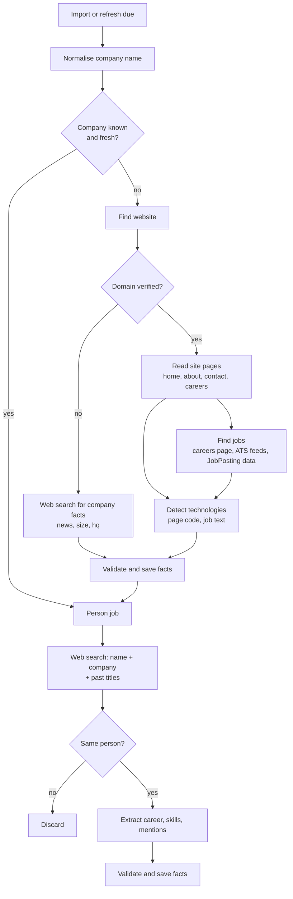

# 04 Research pipeline

The goal is to collect as much work related public data as possible about each company and each person, save it with sources, and reuse it for every search until a refresh finds something newer.

## Rules

- Never fetched: linkedin.com, indeed.com, glassdoor.com (and their country domains), private IP ranges
- robots.txt is respected. Max 1 request per second per site, 10 s timeout, 2 MB per page
- Every fact needs a `sourceUrl` and a supporting `quote`. Facts the AI suggests but cannot quote are dropped
- Work related only: role, employer, dates, skills, talks, articles, public code. Nothing personal
- When nothing is found, save "searched, not found" with the date, so it shows as unknown, not as a gap to retry every hour

## Pipeline

## Step details

### 1. Normalise
Strip legal suffixes (Pvt Ltd, Inc, PLC, LLC), punctuation and case. Merge known spellings. Keep every original spelling in `names`.

### 2. Find the website
1. Web search: `"<company name>" official website` plus location when known
2. Drop blocked domains, directories and social sites
3. Verify: fetch the home page and check the company name appears in the title, footer or schema.org `Organization` data
4. Result: `verified`, `guessed` (found, check failed) or `not_found`

### 3. Read site pages
Fetch with plain HTTP first. If the page body has very little text but loads scripts, fetch again with Playwright. Pages: home, about, team or leadership, contact, careers, plus up to 10 pages from `sitemap.xml` whose paths look relevant.

Extracted: industry, what they sell, size hints, offices, founded year, leadership names.

### 4. Find open jobs
In this order, stopping at the first that returns jobs:
1. Public ATS feeds linked from the careers page: Greenhouse (`boards-api.greenhouse.io`), Lever (`api.lever.co`), Workable, Ashby, SmartRecruiters, BambooHR. These are public JSON endpoints meant for listing jobs
2. schema.org `JobPosting` data on the careers pages
3. The careers page text itself
4. Web search for `"<company>" jobs` on allowed sites (company site, regional job sites that permit it). Indeed and Glassdoor results are dropped

Saved per job: title, location, url, posted date, and a short list of keywords from the description.

### 5. Detect technologies
- Page code: script and link URLs, meta generator, cookies and headers (React, Angular, WordPress, HubSpot, Salesforce, Shopify, AWS CloudFront, Azure, and so on), using a rules file in the repo
- Job text: a dictionary of about 400 technologies (AWS, Azure, Java, .NET, Selenium, Dynamics 365, ...) matched against job descriptions
- Each technology fact records where it was seen, so "uses Azure, from Azure DevOps Engineer job" is shown to users

### 6. Person research
1. Web search with name plus current company, then name plus title
2. For each result, check identity: page mentions the current company, or a past employer already known, or the same title. At least one must match, otherwise discard
3. Extract: past employers with years, titles, skills, talks, articles, podcasts, public GitHub
4. Save as facts. Update `persons.summary.pastEmployers` and `skills`

### 7. Validate and save
- Drop any fact whose quote is not found on the source page
- Drop facts from blocked domains
- If the same fact exists, update `lastSeenAt` instead of adding a copy
- If a refresh finds a different value for a single value field (size, hq), mark the old fact superseded

## Refresh schedule

| Data | Refresh after |
|---|---|
| Open jobs | 7 days |
| Company facts and technologies | 30 days |
| Person facts | 30 days |
| "Not found" results | 30 days |
| Manual "Refresh now" | Immediately, limited to once a day per subject |

## Cost and limits

| Item | Estimate |
|---|---|
| Company (search + extraction) | about $0.02 |
| Person (search + extraction) | about $0.015 |
| 1,136 companies and 1,716 people, first fill | about $49 total, spread over about 5 days at the $10 daily limit |
| Monthly refresh after that | about $15 to $25 |

When the daily limit is reached, jobs return to the queue with a delay until midnight Sri Lanka time. Nothing fails because of the limit.

## Queue behaviour

- One document in the `jobs` collection per subject: `{type: 'company' | 'person' | 'search', subjectId, reason}`
- A claimed job is locked for 5 minutes; up to 3 attempts, then marked failed and shown to the super admin
- Companies run before their people, so person identity checks can use company facts
- Each worker run handles up to 4 jobs at a time and stops after about 4 minutes; cron starts the next run every minute

## Expected coverage

| Data | Expected |
|---|---|
| Verified website | 85 to 95% of companies |
| Open jobs | Most companies with a careers page or ATS |
| Technologies | 70% or more of companies with a website |
| Person career facts | 30 to 60% of people. Many people have nothing public online |

Users should be told this plainly in the app (the data check does this).
