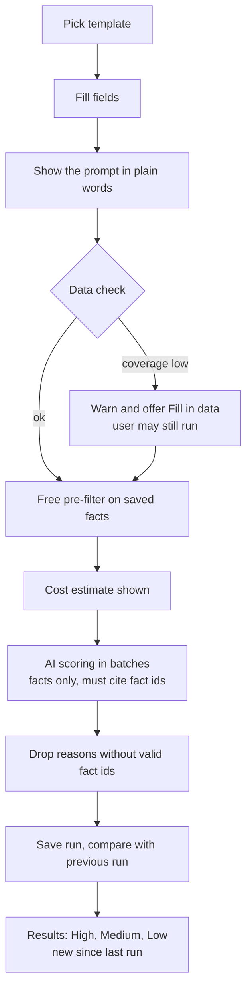

# 06 Searches and templates

## Why templates

Users ask for things like "people who worked at CTP and whose company is hiring". In v1 the AI was asked to judge this from a title and company name only, so it failed. In v2 a search can only ask about data the pipeline collects, and the system checks that data exists before spending money.

## Starting templates

| Template | User fills in | Needs facts |
|---|---|---|
| Decision makers | Roles, industries, locations | title, company industry |
| People at specific companies | Company list | company |
| Alumni of a company | Past employers, current roles, hiring for (optional) | career, job |
| Companies that are hiring | Job areas, technologies | job |
| Uses a technology | Technologies | tech |
| Location and industry | Countries, cities, industries | location, industry |

Templates are shared by everyone and managed by the super admin. Editing one creates a new version. Old runs keep the version they used.

## Template version shape

```json
{
  "fields": [
    { "key": "pastEmployers", "label": "Past employers", "type": "companyList", "required": true },
    { "key": "roles", "label": "Current role", "type": "choice", "options": ["C-level","VP","Director","Head of","Manager","Founder"] },
    { "key": "hiringFor", "label": "Their company is hiring for", "type": "choice", "options": ["Software development","AWS","Azure","Testing"] },
    { "key": "extra", "label": "Anything else", "type": "text", "maxLength": 300 }
  ],
  "requiredFacts": ["career"],
  "optionalFacts": ["job"],
  "prefilter": { "any": [{ "fact": "career.employer", "matches": "{{pastEmployers}}", "fuzzy": true }] },
  "ratingRules": {
    "high": "worked at {{pastEmployers}}, is now {{roles}}, and company is hiring for {{hiringFor}}",
    "medium": "worked at {{pastEmployers}} and holds that role, no matching jobs",
    "low": "no evidence they worked there"
  }
}
```

The "Anything else" text only adjusts ranking inside a rating. It can't add new criteria the system has no data for.

## Search flow



### Data check
For each required fact, count how many contacts in the profile have it. Below 50% shows an amber warning with the number of people who would be scored Low only because of missing data.

### Pre-filter
Runs in the API with no AI cost. Fuzzy matching handles "CTP", "Cambridge Technology Partners" and spelling variants (alias list kept per company). Only contacts that pass are sent to AI. People excluded show as Low with the reason "no saved fact matches".

### AI scoring
- Input per contact: their saved facts with ids, nothing else
- Output: rating, score 0 to 100, one sentence reason, the fact ids it relied on
- A reason that cites no fact, or a fact id that wasn't given, makes the result Low
- Batches of 25 contacts, run in parallel up to 4, all counted against the daily limit

### Run history
- Every run is kept with its inputs and template version
- Results compare with the previous run of the same search: new, moved up, moved down, dropped
- The results screen shows a "New since run N" box and lets users open any older run unchanged

## Guardrails for non technical users

| Problem | What the system does |
|---|---|
| Asks for something no data supports | Not possible, fields come from the template |
| Data missing | Data check warns before running and offers to fill it in |
| Expects the AI to just know | Results say "not found" instead of guessing |
| Trusts a wrong result | Every reason has evidence links to the source page |
| Runs expensive searches repeatedly | Pre-filter cuts cost; unchanged inputs on unchanged data reuse the last run |
| Hits the limit | Run pauses and continues, the user sees why |
